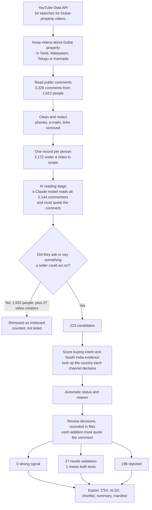

# Dubai Property Prospect Workflow — South India

A re-runnable workflow that looks for people in **Karnataka, Kerala, Tamil Nadu, Telangana and Andhra Pradesh**
who have publicly shown interest in **buying or investing in Dubai property**, classifies each one as
`strong_signal`, `needs_validation` or `reject` with a written reason, and exports the result to a sheet.

It reads public comments only, contacts nobody, and removes phone numbers, e-mail addresses and links before
anything is stored.

## Result at a glance

Run of 11 November 2026, YouTube only, with the AI reading stage on.

| | Count |
|---|---|
| Candidates discovered | **223** |
| Meet both tests in their own words (a wish to buy now and a South India home they state) | **1** |
| Strong signal | **0** |
| Needs validation | **27** |
| Rejected | **196** |

**One person genuinely qualifies on both tests, and does not reach the strong-signal bar.** The other 26 in
"needs validation" show buying interest in their own words, or own property and live in Chennai, but for 23 of
them nothing they wrote says where they live: they are linked to South India only by the language of the video
they commented on. This is a working method and a short list worth a first look, not a list of leads.

| Deliverable | Where |
|---|---|
| Results sheet | [`output/prospects.xlsx`](output/prospects.xlsx) (tabs) · [`output/prospects_all.csv`](output/prospects_all.csv) |
| Shortlist of five | [`output/shortlist_top5.csv`](output/shortlist_top5.csv) |
| Run summary | [`output/summary.md`](output/summary.md) · [`output/run_manifest.json`](output/run_manifest.json) |
| Full rules, columns, settings, troubleshooting | [`docs/DETAILS.md`](docs/DETAILS.md) |
| Dashboard | https://claude.ai/artifact/Uym8RXvyBU5hTYemzAof6r (opens only for people it has been shared with) |

## The short explanation

**Sources.** Public comments under YouTube videos about buying Dubai property, read through the official
YouTube Data API v3. Videos in Tamil, Malayalam, Telugu or Kannada are read up to 2,000 comment threads each,
with the first few replies of each thread;
on the most-commented Dubai-property videos in any language, only comments that name a South India place are
read. Sites that need a login, charge for access or block scripts (LinkedIn, Facebook, Instagram, X, Quora,
reddit.com) were not used and not worked around.

**Qualification rules.** A person must pass two separate tests: buying intent in their own words, and a link to
South India.

| Status | Rule |
|---|---|
| `strong_signal` | A wish to buy plus a specific (budget, timeline, requirement, comparison or process question), a South India home they state themselves, and a signal under 18 months old. |
| `needs_validation` | Intent in their own words (a wish to buy, a budget, a buying question, or a past purchase by someone who states a South India home) with something still missing, usually the location. |
| `reject` | Sellers and agents; renters; requests for only a price, details or a contact with no stated location; replies to other viewers; job-seekers and critics; anyone who says, or whose channel declares, they live outside South India; comments under a video that is not about Dubai. |

A job title, wealth or a location on its own never qualifies anyone. The full rules are in
[`docs/DETAILS.md`](docs/DETAILS.md).

**Discovered versus qualified.** 3,226 comments from 2,612 people → **223 candidates** → **27 need validation**,
of whom **1 meets both tests**; 0 strong signal; 196 rejected.

**Limitations.**

- **Location is the weak link.** Only 2 of the 27 say where they live (both Chennai), and one of those is an
  existing owner, not someone buying now. For 23 the only link is the video's language, and a Tamil or Malayalam speaker may well live in the Gulf: of the candidates
  whose channel declares a country, about half declare one outside India.
- **Evidence per person is thin.** Most rows are one short comment. Identity, finances and residence are
  unverified and listed per row.
- **Concentrated source.** YouTube only. 97 of the 223 candidates come from one channel and 131 from three
  videos. No one who needs validation is linked to Karnataka.
- **Keyword rules miss regional-language buyers.** Against an independent read they found fewer than half of
  the people showing buying intent. Seven of the 27 were added by a recorded review decision.
- **Built with an AI coding assistant**, as the brief allows, including the review decisions. They are one
  reviewer's judgement and have not been checked by a speaker of these languages.

## How it works



| Step | File |
|---|---|
| Discover and read comments | [`prospector/sources/youtube.py`](prospector/sources/youtube.py) |
| Redaction, intent markers, location evidence | [`prospector/textsig.py`](prospector/textsig.py), patterns in [`prospector/lexicon.py`](prospector/lexicon.py) |
| One record per person, status and reason | [`prospector/qualify.py`](prospector/qualify.py) |
| Processing order, review decisions, shortlist | [`prospector/pipeline.py`](prospector/pipeline.py) |
| CSV, XLSX, summary, manifest | [`prospector/export.py`](prospector/export.py) |
| AI reading stage (optional; on for these results) | [`prospector/ai_reader.py`](prospector/ai_reader.py) |

## Setup guide

Everything needed is free. Allow about ten minutes.

**You need:** Python 3.10 or newer (developed on 3.13), Git, and a Google account for the free API key.

**1. Get the code and install the two dependencies.**

```bash
git clone https://github.com/MINTU296/dubai-prospect-workflow
```

```bash
cd dubai-prospect-workflow
```

```bash
pip install -r requirements.txt
```

A virtual environment is optional: `python3 -m venv .venv` then `source .venv/bin/activate` (on Windows,
`py -m venv .venv` then `.venv\Scripts\Activate.ps1`).

**2. Create a YouTube Data API key.**

1. In the [Google Cloud Console](https://console.cloud.google.com/projectcreate), create a project.
2. On the [YouTube Data API v3 page](https://console.cloud.google.com/apis/library/youtube.googleapis.com),
   click **Enable**.
3. Under [Credentials](https://console.cloud.google.com/apis/credentials), choose
   **Create credentials → API key** and copy it.

**3. Give the key to the workflow.** Copy the template and paste the key after the `=` sign:

```bash
cp .env.example .env
```

```text
YOUTUBE_API_KEY=paste-your-key-here
```

`.env` is ignored by git. An environment variable of the same name also works and takes precedence.

**4. Run it.**

```bash
python run.py
```

A first run takes a few minutes and uses about 6,700 of the 10,000 free daily quota units. It writes five files
to `output/`. To view the sheet in Google Sheets, choose **File → Import → Upload** and select
`prospects.xlsx`.

**5. Check the installation (optional).**

```bash
pip install -r requirements-dev.txt
```

```bash
python -m pytest tests -q
```

248 tests pass and one is skipped (it needs the optional `anthropic` package); none needs a key or the network.

| Command | What it does |
|---|---|
| `python run.py` | Collect, qualify, export. Reuses cached answers under 24 hours old. |
| `python run.py --offline` | Re-qualify from your local cache: no network, no quota. |
| `python run.py --ai-read` | Also have a Claude model read every commenter. Needs `ANTHROPIC_API_KEY` in `.env` and `pip install -r requirements-ai.txt`; the run for these results cost about $5. |
| `python run.py --refresh` | Ignore the cache and fetch again. |
| `python run.py --as-of 2026-11-11` | Make freshness decisions as of a given date. |
| `python run.py --find "some words"` | Show the id and status of everyone whose comment contains the words. |
| `python run.py --purge-cache` | Delete all cached public text. |
| `python run.py --help` | Every option, and the exit codes. |

**Re-runnable, not byte-reproducible.** The cache is not in the repository and YouTube's search results change,
so a fresh run finds a somewhat different set of people. The committed `output/` reproduces exactly from the
author's cache with `python run.py --offline --ai-read --as-of 2026-11-11`; `run_manifest.json` records the commit, settings and checksums.

## Results

| Funnel step | Count |
|---|---|
| Public comments read | 3,226 |
| People who wrote them | 2,612 |
| People with a comment under a Dubai-property video that is short or on topic | 2,172 |
| Video creators' own comments removed | 27 |
| Removed as irrelevant (asked nothing, no wish to buy) | 1,922 |
| **Candidates discovered** | **223** |
| `strong_signal` | **0** |
| `needs_validation` | **27** |
| ...of whom meet both tests in their own words | **1** |
| `reject` | **196** |

**The 27 who need validation.** Twelve say they want to buy or invest (two state an amount: 25 lakh and
3 crore), thirteen asked a buying question such as "How much down payment?", one says he already bought and
lives in Chennai, and one wrote "Interested" under a video about a Dubai property show in Hyderabad. Twenty
were found by the rules and seven by a review decision. Location: two state Chennai, one names a Hyderabad
locality without calling it home, one is tied to Hyderabad only by that event video, and 23 are linked only by
video language (Tamil 16, Malayalam 4, Telugu 3). Fourteen of the 27 commented on one Tamil realtor's channel.

**The 196 rejected.**

| Reason | Count |
|---|---|
| Only asked for a price, details or a contact, and gave no location | 130 |
| Commented under a video that is about a villa in Ajman, not Dubai | 19 |
| Seller or agent, by what they wrote (6) or by a business-name handle (6) | 12 |
| Replied to another viewer rather than the creator | 8 |
| Rejected by a review decision | 15 |
| Channel declares a country outside India | 5 |
| Says they live elsewhere, owner with no sign of buying again, advice-giver, critic, job-seeker, no South India link | 7 |

**The shortlist.** Anyone who meets both tests comes first; after that the order is a stated wish to buy and
its specifics, then location the person states themselves. Only the first meets both tests. The second names a
Hyderabad locality but does not say he lives there, the third states a 25-lakh budget, the fourth says he is in
India, and the fifth is an existing owner in Chennai, not someone who says he is buying again.

**Why nobody reaches strong signal.** It needs a wish to buy, a specific, and a stated South India home in the
same public record. People who comment on these videos ask one short question and rarely say where they live.
Three further checks for location were measured and found nearly empty: the country a channel declares (17 of
223 declare one), the channel description (3 candidates named a South India place, all three rejected for
other reasons), and an independent read of every comment for a stated home (10 found, none with buying
intent).

## What was checked

- **Independent read.** Six AI readers labelled 1,552 commenters (the data at the time) without seeing the
  rules' verdicts, quoting the comment for every label. The rules had found 34 of the 79 people in whom the
  readers saw buying intent. General rules were added for the gaps that generalise.
- **Three independent reviews** of the results and the code then found real faults, now fixed:
  - about a quarter of the rows then listed as needing validation did not survive a strict read, including
    several added by review decision, and one source video was about Ajman, not Dubai;
  - the classifier let renters, sellers and adverts through, read denials in Tamil and Malayalam as intent,
    and rejected buyers who named Dubai as where the flat is as if they lived there;
  - a home was sometimes invented: a friend's city, or the Malayalam word for "years", which is also the name
    of the city Kollam;
  - a review decision could qualify someone without quoting them; it now cannot, and can never lift a seller;
  - the README called 46 people "qualified" when one met both tests.

  Every input those reviews found misclassified is now a test. Each review still found new phrasings the
  keyword rules got wrong, so expect more: that is the limit of keyword rules.
- **AI reading stage, run live.** A Claude model (`claude-opus-5-5`) read all 2,144 commenters in 104 requests
  in about five minutes, with no failed request and no quote that failed the exact-match check.
  - It agrees with the sheet: it reads buying interest in 26 of the 27 rows to validate (the 27th is the
    "Interested" under the Hyderabad event video), and reads 129 of the 130 price-only rejects the same way.
  - It found buying intent in 28 people the rules had missed. On a strict read most of the medium-confidence
    ones were vague or off-target, so only a high-confidence reading may add intent. That left five, and none
    became a row to validate: two are replies between viewers, one is under the Ajman video, one is a
    Singapore citizen and one is under a video about the UAE generally. One medium-confidence reading (a
    Malayalam question about paying 63,000 dirhams) was accepted by a review decision.
  - Every row's reading, quote and English translation is in the `ai_reading` column.
- **Not checked.** No speaker of Tamil, Malayalam, Telugu or Kannada has read the regional-language rows.

## Privacy and compliance

- **Redaction.** Phone numbers, e-mail addresses, links and handles on other platforms are replaced by tokens
  before anything is cached or exported, in comment text, display names, and video titles, descriptions and
  tags. It is pattern-based and will miss unusual formats. A @mention of another YouTube user inside a comment
  is kept, because it is part of the public comment.
- **Minimal lookups.** For a candidate's channel only the declared country code is requested and cached.
- **Retention.** Cached text older than 30 days is deleted on the next online run; `--purge-cache` deletes it
  at once. The committed `output/` holds 223 public handles with a judgement against each, exists for this
  evaluation only, and should be deleted afterwards.
- **Removal on request.** A row with status `exclude` in `review/manual_review.csv` removes that person from
  every output.
- **Read-only.** Nothing is posted and nobody is messaged. The API key is sent in a header and never logged.
- **Open question.** Compiling commenters' handles into a prospect list may sit uneasily with YouTube's API
  developer policies. I have not resolved that; it should be checked before any real use.

## Next steps

1. A consented validation step, such as a form linked from a developer's own channel, before any record is
   treated as a lead. It is also the only way to establish residence.
2. Have a speaker of each language read the regional-language rows.
3. Compare the AI reading stage's translations with a speaker's on a sample.
4. More Kannada and Telugu sources; the current ones are thin.
