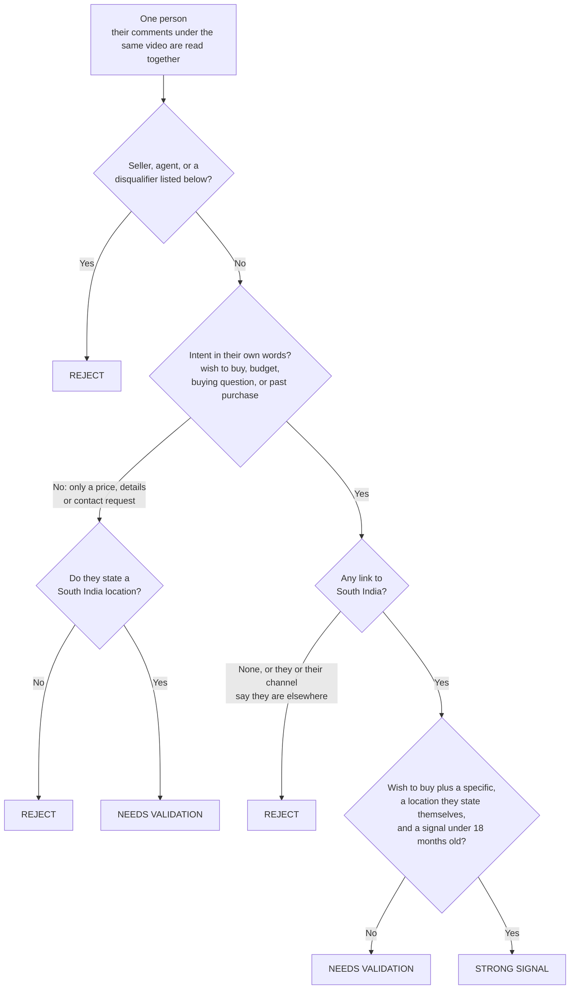

# Details

The [README](../README.md) is the short version. This page holds the full rules, the output columns, the
optional AI reading stage, the review workflow, settings, failure handling and troubleshooting.

## Qualification rules

A person must pass **two independent tests**: Dubai buying intent in their own words, and a link to South India.



Disqualifiers, checked in this order:

1. The video's own creator, a seller or agent, or a handle that reads as a business name.
2. The comment is under a video a reviewer found is not about Dubai property, and nothing in the person's
   own words points to Dubai (see `review/video_review.csv`).
3. A renter or someone selling their own property, unless they also say they want to buy.
4. A job-seeker, a critic, or someone advising others, unless the comment is otherwise specific about buying.
5. A reply under another viewer's comment rather than to the creator.
6. Buying in India, not Dubai.
7. They say, or their channel declares, that they live outside South India, and they state no South India base.
8. An existing owner with no sign of buying again and no stated South India base.
9. Only a price, details or contact request, with no stated location and not under a video about an event
   held in a South India city.

A job title, wealth or a location on its own never produces a positive status.

### Buying-intent markers

| Marker | What it is | Examples |
|---|---|---|
| `purchase_intent` | A first-person wish or ability to buy or invest in property. Not "you", "my brother" or "investors", not denied, and not gold, a car or tickets. | "I want to invest" · "how to buy" · "oru villa vangan kazhiyumo" · "ఇల్లు కొనాలి" |
| `budget` | An amount with a unit, next to a first-person or asked-about cue. | "my budget is 60 lakhs" · "I have only 25L" |
| `requirement` | A unit type, a payment term, or a named Dubai community or developer. | "2BHK" · "off-plan" · "down payment" · "JVC" |
| `timeline` | When they plan to act. Urgency words such as "asap" do not count. | "next year" · "within 6 months" |
| `comparison` | Weighing options, in a comment that is itself about property. | "Dubai vs Bangalore" |
| `process_question` | The buying process, asked as a real question. | "what is the rental yield?" |
| `buying_question` | A short, real question about the process or a specific unit, area or payment term. Not a renter's question ("2bhk rent how much?") and not a bare "details" request. | "How much down payment?" · "emi എത്ര" |
| `owner_investor` | Says they already bought. | "I bought a flat there" |
| `enquiry` | Asks for a price, details or the seller's contact, or says "interested". All treated alike. A price or detail word counts only in a short question or request, not in commentary. | "price?" · "contact number" |

### Intent level

| Level | Rule |
|---|---|
| **strong** | `purchase_intent` plus a specific (budget, timeline, requirement, comparison or process question), or a budget plus a requirement or timeline. |
| **medium** | Intent in their own words without that: a wish to buy, a budget, a buying question, or a past purchase. |
| **weak** | Only an `enquiry`. Asking for a phone number is not treated as stronger than "details please". |

### South India evidence, strongest first

| Evidence | Meaning |
|---|---|
| **explicit** | The person says they live in or are from a place, in the first person and not negated. Understood in English, romanised regional languages ("naan Madurai la irukken") and native script ("நான் மதுரையில் இருக்கிறேன்"). |
| **community** | For forum-type sources only (not used in this run): posted in, or publicly active in, a South India community. |
| **mention** | A place is named, but not as their home. |
| **context** | Commented on a video about an event held in a South India city. |
| **language** | Commented on a regional-language video, or wrote in that script. This suggests a region; it does not show where anyone lives. |

Only **explicit** and **community** can support a strong signal. A comment in a regional script is matched on
keywords only, so it is always flagged for a human read and cannot be a strong signal on the rules alone.
A place outside South India counts as the person's home only with a residence verb ("naan Dubai la irukken"),
not when it is where the property is ("naan Dubai la oru 2BHK vaanganum").

### The AI reading stage

Keyword rules read English well, and the four regional languages only through short word lists. The optional
stage `python run.py --ai-read` asks a Claude model (`claude-opus-5-5` by default) to read every commenter's
comments in whatever language they are written and to return, per person: the intent, a stated home, the
language, an English gloss, and how confident it is.

It is one model call per batch of 20 people inside a fixed pipeline, not an autonomous agent: it cannot
browse, choose sources or contact anyone. What it may and may not do is fixed in code:

| Guardrail | How it is enforced |
|---|---|
| No invented evidence | Every finding must quote the comment. A quote that is not an exact substring of that person's comments is discarded in code. |
| Limited authority | Only a high-confidence reading can add intent, and only up to `needs_validation`. It can never produce a `strong_signal`. |
| Visible provenance | Such a row carries the marker `read_by_ai`, a reason that says so, and the reading itself in the `ai_reading` column. |
| Rules keep the veto | Every disqualifier still applies. Where the model disagrees with a row the rules qualified, or reports a stated home outside South India, the row is flagged for a human, never changed or rejected. |
| Minimal data sent | Only redacted comment text and the video title. No handle, channel id or link; @mentions of other viewers are replaced before sending. |
| Repeatable | Readings are cached per distinct text, model and prompt version; identical comments are read once. |
| Safe to fail | No key, a rejected key, a network error, a declined request or a malformed answer skips that batch; the run continues on the rules. |

**Status: run live for the committed results** (2,144 commenters, 104 requests, no failures). Only a
high-confidence reading may add intent; the README describes what it found.

### Other rules

- **Candidate.** A unique person who asked or said something a seller could act on, or who is a seller. A
  video's own creator and people who only comment on the topic are counted and removed. Every candidate is
  listed; there is no cap.
- **Dedupe.** Exact repeat texts are collapsed, then all comments by one channel become one prospect.
- **Shortlist.** Up to five non-rejected prospects. Anyone who meets both tests (a wish to buy now and a home
  they state) comes first. After that the order is a score: a stated wish to buy counts most, then each
  specific (budget, timeline, comparison), then location the person states themselves, with a signal older
  than 18 months marked down. An existing owner counts for less than someone buying now.
- **Review decisions.** After the automatic run every non-rejected row was read again, and decisions are
  recorded in [`review/manual_review.csv`](../review/manual_review.csv). A decision in someone's favour must
  name the signal and give the exact quote it rests on; if either is missing, or the quote is not in the
  person's comments, the decision is not applied. No decision can turn a seller or a video's creator into a
  prospect. The rules still classify an added person. These decisions were made during development with an
  AI assistant and are one reviewer's judgement.
- **Video decisions.** [`review/video_review.csv`](../review/video_review.csv) lists videos found not to be
  about Dubai property. One is listed: a vlog about a villa in Ajman.


## Output columns

| Column | Content |
|---|---|
| `prospect_id` | Stable id for the person. |
| `public_name_or_handle`, `platform` | Public handle and source. |
| `city`, `state` | Filled only when the person states it as their home; otherwise `unknown`. |
| `location_confidence` | explicit, community, mention, context or language. |
| `inferred_region` | A region suggested by the video's language, an event, or a place the person only mentions. Kept apart so a guess is never shown as someone's city. |
| `channel_country` | The country the person's channel publicly declares. Blank for most. |
| `location_evidence` | The quote and link behind the location. |
| `source_link`, `signal_date`, `signal_context` | Link to the comment, its date, and the video it is under. |
| `evidence_of_interest` | The person's own words. |
| `intent_level`, `intent_markers` | Strong, medium or weak, and the markers found. |
| `qualification_status`, `qualification_reason` | The status and why, including what to confirm. |
| `meets_both_tests` | `yes` only when the row is not rejected, the person says they want to buy or asks a buying question, and they state a South India home. A past purchase alone does not count. |
| `unverified_information` | What remains unverified for this person. |
| `review` | `automatic`, or the manual reviewer's note. |
| `ai_reading` | What the optional AI reading stage saw: intent, quote, stated home, English gloss. Blank when the stage was not run. |
| `signals_by_author`, `other_source_links` | How many relevant comments they made, and links to the others. |


## Review workflow

1. Find the person's `prospect_id` in the sheet. Someone who is not a candidate is not in the sheet: run
   `python run.py --find "some words from their comment"` to get their id.
2. Add a line to [`review/manual_review.csv`](../review/manual_review.csv): `prospect_id,status,note,signal,quote`. The
   status is `strong_signal`, `needs_validation`, `reject`, or `exclude` to remove the person from every
   output. The optional `signal` (`wants_to_buy`, `buying_question` or `already_bought`) records what you read
   in a comment no keyword rule matched; add `+budget`, `+timeline`, `+comparison` or `+requirement` for
   specifics you read. `quote` is the exact text it rests on and must be found in the person's comments.
3. Run `python run.py --offline`. The sheet's `review` column shows your note.


## Settings

Settings are in [`config.py`](../config.py); the numeric ones and the search lists are checked when the run starts.

| Setting | What it controls |
|---|---|
| `YOUTUBE_QUERIES` | The searches used to find videos. Each costs 100 quota units. |
| `SIGNAL_AFTER` | Comments older than this date are ignored. |
| `FRESH_MONTHS` | A signal older than this cannot be a strong signal. |
| `YOUTUBE_QUOTA_BUDGET` | The most quota one run may use. |
| `YOUTUBE_CHANNEL_COUNTRY` | Whether to look up the country each candidate's channel declares. |
| `AI_MODEL`, `AI_EFFORT`, `AI_BATCH_SIZE`, `AI_WORKERS` | The model and request sizes used by the optional AI reading stage. |
| `YOUTUBE_COMMENT_PAGES` | How many pages of 100 comment threads are read per video (20). |
| `CACHE_TTL_HOURS`, `CACHE_RETENTION_DAYS` | How long cached answers are reused, and when cached text is deleted (on the next online run). |

Keyword rules and the place gazetteer are in [`prospector/lexicon.py`](../prospector/lexicon.py).


## Optional: the AI reading stage, setup

This stage is not needed to reproduce the committed results, and it is the only part that costs money.

1. Install its one extra package:

```bash
pip install -r requirements-ai.txt
```

2. Create a key at [console.anthropic.com](https://console.anthropic.com/settings/keys) and add it to `.env`:

```text
ANTHROPIC_API_KEY=paste-your-key-here
```

3. Run with the stage switched on:

```bash
python run.py --ai-read
```

Readings are cached, so a second run sends nothing. Without a key the flag does no harm: the run logs a
warning and uses the keyword rules and any cached readings.


## Reliability and tests

| Failure | What happens |
|---|---|
| Network error, HTTP 429 or 5xx | Retried with backoff; never cached. |
| API still failing | A circuit breaker stops after repeated failures; the last cached answer is used if there is one. |
| Quota exhausted or key rejected | The collector switches to cached data and says so, also when `--refresh` was asked for. |
| No API key | No call is made; with no cache the run exits 3. |
| AI reading stage fails (no key, bad key, network, declined request, malformed answer) | That batch is skipped and the run continues on the keyword rules. |
| Run interrupted | Cache and output writes are atomic. |
| Nothing collected | Exit code 3; existing outputs are left untouched. |
| Malformed rows, missing author or date | Skipped and counted. |
| Mis-edited `config.py`, bad arguments | Rejected at start with exit code 2. |

The 249 tests cover the rules on realistic English, romanised and native-script phrasing, text cleaning, the
cache, the YouTube collector end to end against a stand-in API, the AI reading stage against a stand-in, the
pipeline and the export. One test needs the optional `anthropic` package and is skipped without it. They are written by the same author as the rules, so they show the rules do what was
intended, not that the intent is right. The two independent reviews described in the README are the check on
that, and every input they found misclassified is now a test. A CI workflow is
included, but GitHub Actions is not currently running on this repository.


## Troubleshooting

| What you see | Cause and fix |
|---|---|
| `no working YOUTUBE_API_KEY` followed by `nothing was collected`, exit code 3 | The key is missing, mistyped, or the API is not enabled on its project. Check the line in `.env` (no spaces or quotes around the key), or repeat steps 2 and 3 of the README's setup guide. |
| `youtube: API quota exhausted - continuing with cached data only` | The free daily quota is used up. It resets at midnight Pacific time; run again then. Results already cached are kept. |
| `youtube: API key rejected (...)` | The key was deleted or restricted to another API. Create a new one or fix its restriction. |
| `--offline` exits with code 3 | There is no local cache yet. Do one normal run first. |
| `ModuleNotFoundError: No module named 'requests'` | The virtual environment is not active, or the install in step 1 was skipped. |
| `python: command not found` | Use `python3` on macOS or Linux, or `py` on Windows. |
| PowerShell says running scripts is disabled when activating `.venv` | Run `Set-ExecutionPolicy -Scope Process RemoteSigned` in that window, then activate again. |
| Exit code 2 with a `config:` message | A value in `config.py` is invalid; the message names it. |
| Different numbers from the committed results | Expected. YouTube's search results change, so each fresh run finds a somewhat different set of people. |

**Exit codes:** 0 success · 1 unexpected error · 2 bad configuration or arguments · 3 nothing collected
(existing outputs are left untouched).


